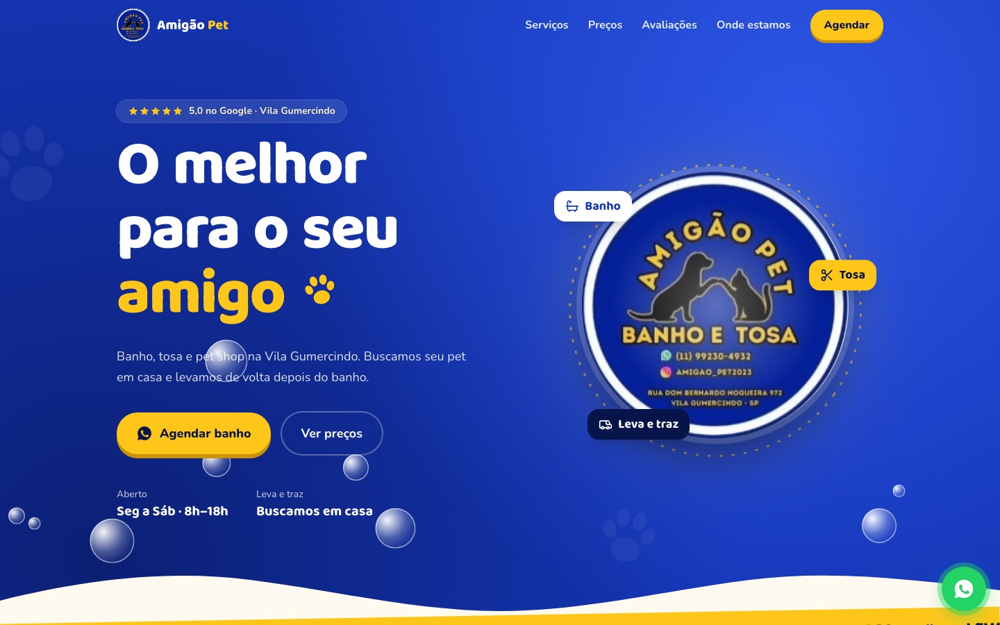

# Amigão Pet — site de banho e tosa

Site de um pet shop de bairro na Vila Gumercindo, em São Paulo. Feito pela [Averon](https://averon-digital.web.app) pra apresentar os serviços e levar o cliente direto pro WhatsApp.

**No ar:** https://amigao-pet-site.vercel.app



## O que tem de interessante

- **Calculadora de preço** (`src/Pricing.jsx`): o cliente escolhe cachorro ou gato, porte, tipo de tosa, extras e o leva e traz, e o total muda na hora. Também mostra quanto sai o pacote mensal com desconto. Os valores são de exemplo.
- **Tudo vira WhatsApp**: os botões montam a mensagem já com o serviço escolhido, então o dono recebe o pedido pronto.
- **Dados num arquivo só**: serviços, preços, endereço e avaliações ficam em `src/data.js`.
- **Identidade de bairro**: azul e amarelo da marca, bolhas de sabão, preloader "Preparando o banho..." e animações com GSAP, Lenis e Motion. As animações respeitam o `prefers-reduced-motion`.

## Números

Medido com o Lighthouse 12 em 23/10/2026, no site publicado:

| | Desempenho | Acessibilidade | Boas práticas |
|---|---|---|---|
| Desktop | 96 | 93 | 100 |
| Celular | 74 | 93 | 100 |

O site está com `noindex` de propósito, porque é uma proposta com preços de exemplo e ainda não deve aparecer no Google. Por isso o SEO não entra na tabela.

## Quem fez

Projeto da Averon. Toda a programação foi feita por mim: estrutura, calculadora, animações e deploy.

## Stack

React 19 · Vite · Tailwind CSS v4 · GSAP · Lenis · Motion · Vercel

## Rodando local

```bash
npm install
npm run dev
```

---

**EN:** Website for a neighborhood pet grooming shop in São Paulo, live on Vercel. Built with React, Vite, Tailwind v4 and GSAP. The highlight is a live price calculator (pet, size, grooming type, extras, pickup and monthly plan) that hands the order off to WhatsApp with the message already filled in.

---

© Pietro Andrade / Averon. Todos os direitos reservados. O código está público apenas como portfólio; não é permitido reutilizá-lo.
